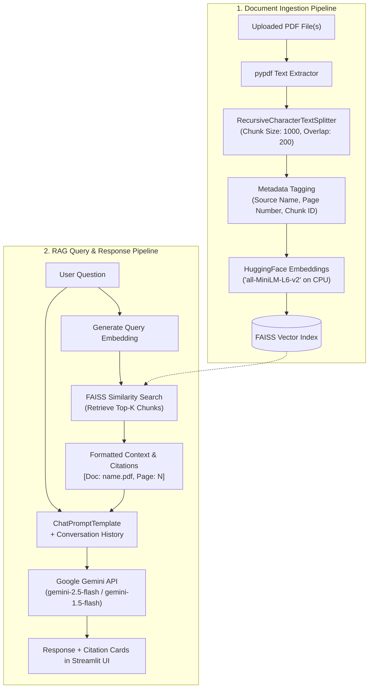

# DocuMind – AI Powered PDF Chatbot

[](https://www.python.org/)
[](https://streamlit.io/)
[](https://python.langchain.com/)
[](https://github.com/facebookresearch/faiss)
[](https://ai.google.dev/)
[](LICENSE)

**DocuMind** is a production-ready, open-source Generative AI application that allows users to upload PDF documents and ask questions about their contents in natural language. Powered by **Retrieval-Augmented Generation (RAG)**, DocuMind combines local semantic vector search via **FAISS** and **HuggingFace Sentence-Transformers** with **Google's Gemini Large Language Model** to provide accurate, hallucination-resistant answers with verifiable source document and page number citations.

---

## 📌 Problem Statement

Traditional LLMs suffer from knowledge cutoffs and hallucinations when queried about proprietary, confidential, or recently generated documents (such as academic papers, financial reports, technical manuals, or legal contracts). Searching through lengthy multi-page PDFs manually is time-consuming and inefficient.

**DocuMind** bridges this gap by grounding AI responses directly in the uploaded documents. By retrieving only the most relevant text chunks and passing them as verified context to Google Gemini, DocuMind ensures high fidelity, zero external hallucination, and clear traceability.

---

## 🎯 Project Objectives

- Provide a beginner-friendly yet production-structured GenAI project for portfolios and real-world utility.
- Demonstrate modern **Retrieval-Augmented Generation (RAG)** patterns using LangChain without deprecated APIs.
- Eliminate external vector database fees and API rate limits by leveraging **local FAISS vector storage** and **HuggingFace MiniLM embeddings** running on CPU.
- Implement strict guardrails preventing hallucinations when requested information is absent from documents.
- Present a modern, responsive, intuitive UI built in Streamlit with session state management and expandable source citations.

---

## 🚀 Key Features

1. **Multi-Document PDF Ingestion**: Upload single or multiple PDF documents simultaneously.
2. **Page-Aware Text Extraction**: Extracts clean text while tracking source filenames and exact page numbers.
3. **Semantic Text Chunking**: Splits lengthy text into contextual chunks using `RecursiveCharacterTextSplitter` with configurable size and overlap.
4. **Local CPU Embeddings**: Generates 384-dimensional dense vector embeddings using `all-MiniLM-L6-v2`—no Hugging Face token required.
5. **High-Speed Vector Search**: Indexes and retrieves top semantic matches using Facebook AI Similarity Search (FAISS).
6. **Hallucination-Guarded RAG**: Custom system instructions direct Google Gemini to answer strictly from retrieved context and declare when information is missing.
7. **Source Document & Page Citations**: Displays clickable expander cards beneath every AI response detailing source files, page numbers, and quoted snippets.
8. **Interactive Chat Experience**: Multi-turn conversation history stored in session state with one-click conversation reset.
9. **Secure Configuration**: Reads secrets from `.env` with a masked sidebar fallback; zero hardcoded credentials.
10. **Robust Error Handling**: Gracefully handles scanned/empty PDFs, password-protected files, invalid API keys, and quota limits.

---

## 🏗️ Architecture & Workflow



---

## 🛠️ Technology Stack

| Layer | Technology | Purpose |
| :--- | :--- | :--- |
| **Frontend** | Streamlit | Responsive web UI, session state, and chat components |
| **LLM Provider** | Google Gemini API (`gemini-2.5-flash`) | Context reasoning and natural language synthesis |
| **Orchestration** | LangChain (LCEL) | Modular RAG pipeline, prompts, and document loaders |
| **Embeddings** | HuggingFace `sentence-transformers` | 384-dim local CPU embeddings (`all-MiniLM-L6-v2`) |
| **Vector DB** | FAISS (`faiss-cpu`) | In-memory similarity search and index persistence |
| **PDF Extraction** | PyPDF | Fast, page-by-page PDF parsing and metadata extraction |
| **Environment** | python-dotenv | Secure API key and parameter configuration |

---

## 📂 Project Folder Structure

```
documind/
├── .env.example              # Template for environment variables
├── .gitignore                # Excludes secrets, virtual environments, and cache
├── README.md                 # Project documentation and architectural overview
├── requirements.txt          # Production package dependencies
├── config.py                 # Central application configuration and constants
├── app.py                    # Streamlit frontend application and state management
├── assets/                   # Static media and screenshots
│   └── .gitkeep
└── src/                      # Modular backend package
    ├── __init__.py           # Package marker
    ├── pdf_processor.py      # PDF extraction, validation, and chunking
    ├── embeddings.py         # HuggingFace embedding manager with caching
    ├── vector_store.py       # FAISS vector store creation, indexing, and retrieval
    └── rag_pipeline.py       # LangChain LCEL RAG pipeline with Google Gemini
```

---

## ⚡ Installation & Setup

### Prerequisites
- Python 3.10, 3.11, or 3.12 installed on your system.
- A free Google Gemini API Key from [Google AI Studio](https://aistudio.google.com/app/apikey).

### Step 1: Clone the Repository
```bash
git clone https://github.com/siri0551/documind.git
cd documind
```

### Step 2: Create and Activate a Virtual Environment
- **On Windows (PowerShell):**
  ```powershell
  python -m venv venv
  .\venv\Scripts\Activate.ps1
  ```
- **On macOS / Linux:**
  ```bash
  python3 -m venv venv
  source venv/bin/activate
  ```

### Step 3: Install Required Dependencies
```bash
pip install --upgrade pip
pip install -r requirements.txt
```

### Step 4: Configure Your Environment Variables
Copy `.env.example` to `.env`:
```bash
cp .env.example .env
```
Open `.env` in any text editor and enter your Gemini API key:
```ini
GOOGLE_API_KEY=AIzaSyYourActualKeyHere
```
*(Alternatively, you can enter your API key directly into the Streamlit sidebar at runtime.)*

---

## 🖥️ Running the Application

Launch the Streamlit web server:
```bash
streamlit run app.py
```

Once launched, open your web browser at:
```
http://localhost:8501
```

---

## 💡 How to Use

1. **Configure API Key**: Ensure your Gemini API Key is detected from `.env` or input it in the sidebar.
2. **Upload Documents**: Browse and select one or multiple PDF files in the sidebar.
3. **Process PDFs**: Click **"⚡ Process PDFs"**. DocuMind will extract pages, generate embeddings, and build the FAISS index.
4. **Chat**: Type questions in the chat input at the bottom.
5. **Inspect Sources**: Expand the **"📚 Source Citations"** card beneath each assistant answer to see the exact document, page number, and quote snippet used.
6. **Reset / Clear**: Click **"Clear Chat"** to wipe message history, or **"Reset All"** to clear indexed documents.

---

## 💬 Example Questions to Try

- *"What is the main objective or thesis of this document?"*
- *"Summarize the key findings in Section 3 in three concise bullet points."*
- *"What methodology or technical approach did the authors implement?"*
- *"Are there any limitations or future works mentioned in the conclusion?"*
- *"What was the total revenue reported on page 5?"*

---

## 🖼️ Screenshots

| Modern Chat Interface | Source Citations & PDF Stats |
| :---: | :---: |
| *(Add your screenshot here: `assets/chat_ui.png`)* | *(Add your screenshot here: `assets/citations.png`)* |

---

## 🔮 Future Enhancements

- [ ] **OCR Integration**: Add Tesseract OCR for scanned PDF documents and image-only pages.
- [ ] **Tabular Data Support**: Enhanced table extraction using `pdfplumber` or Camelot.
- [ ] **Hybrid Search**: Combine BM25 keyword matching with FAISS dense vector search (Reciprocal Rank Fusion).
- [ ] **Voice Interaction**: Speech-to-text input via Whisper and audio response playback.
- [ ] **Export Chat History**: Download conversation logs and citations as Markdown or PDF summaries.

---

## 📤 Pushing to Your GitHub Portfolio

To publish this project to your GitHub account:

1. Create a new public repository on [GitHub](https://github.com/new) named **`documind`** (leave "Initialize with README" unchecked).
2. The local repository is already initialized and committed. Run the following commands in PowerShell from the project folder:
   ```bash
   cd documind

   # Origin remote is configured for your profile
   git remote set-url origin https://github.com/siri0551/documind.git

   # Push code to your GitHub repository
   git push -u origin main
   ```

---

## 👤 Author

- **GitHub Profile**: [@siri0551](https://github.com/siri0551)
- **Project Repository**: [siri0551/documind](https://github.com/siri0551/documind)

---

## 📄 License

This project is licensed under the [MIT License](LICENSE) — free to use and customize for educational and portfolio purposes.
